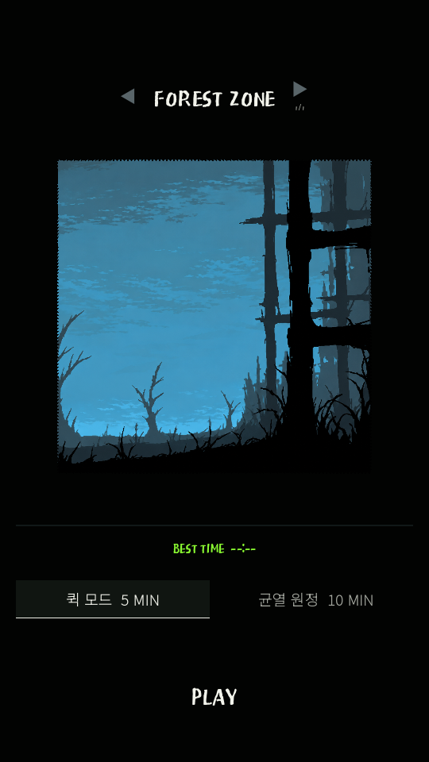
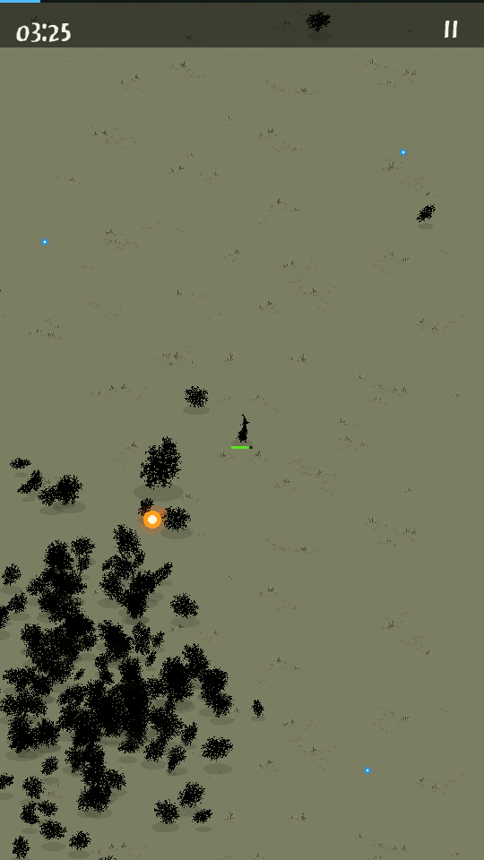
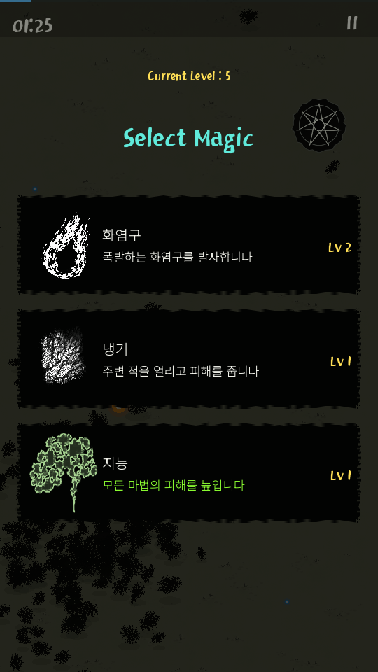
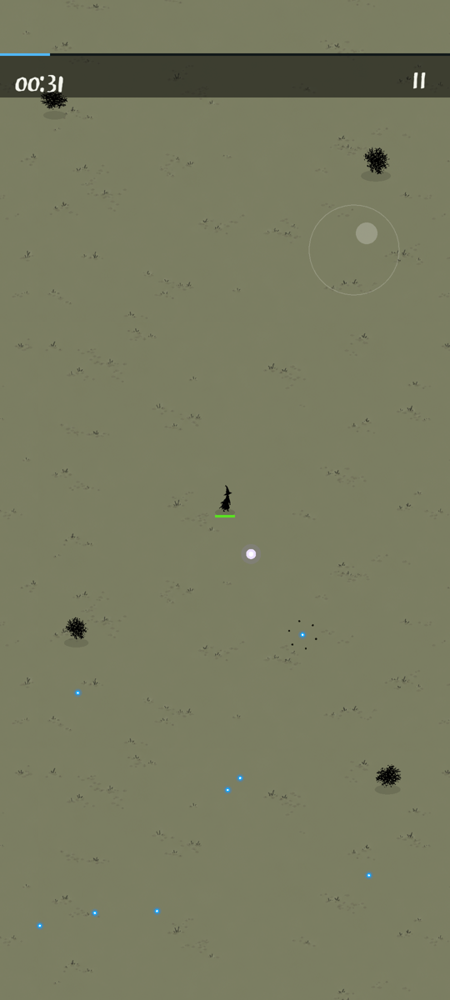
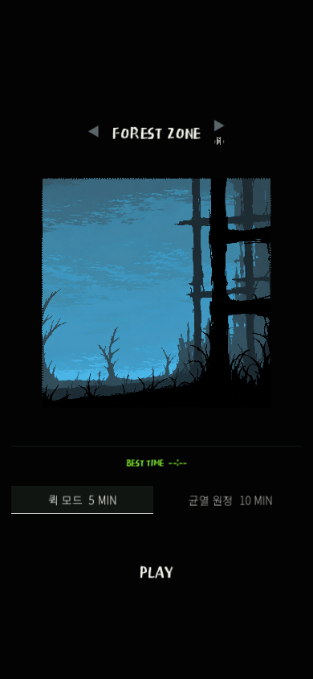
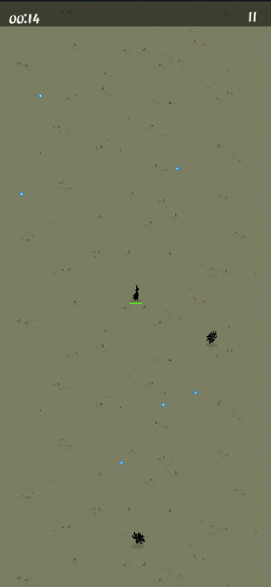
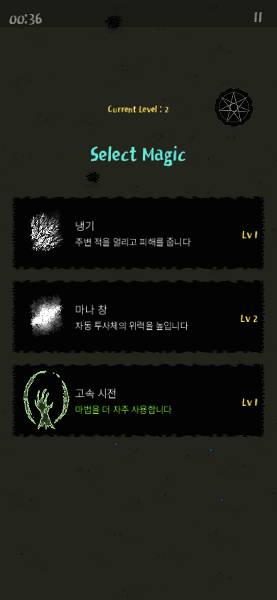
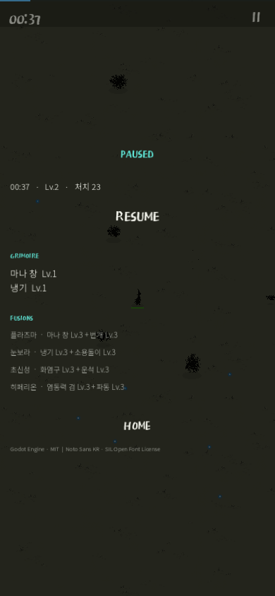

# 원작 기준 시각 수정 · 검증 경계

2026-10-29 / Android 0.2.0 / Godot 4.7 stable.

## 바뀐 화면

- 검정 메뉴·푸른 숲과 PLAY, 실제 모드별 최고 기록.
- 올리브 전장, 작은 로브 플레이어, 먹선 적·보스, 플레이어 아래 녹색 HP.
- 얇은 시간·XP·정지 HUD, 화면 밖 보스 방향 안내.
- 청록색 제목, 거친 검정 선택 카드, 흰 문양·노란 레벨, 오컬트 장식.
- 정지·결과 행동 글자와 터치 영역 확대. UI 외 전투 영역 어디서나 드래그 이동.
- 저장 프로젝트 이름·패키지 ID·전투 규칙 8마법/4조합/12유물 유지.

## 실제 확인

원작 공식 메뉴·전투·선택 화면과 같은 비율로 나란히 비교했다. 독립 시각 검토는 90/100, 시각 범주 일치로 판정했다. 남은 차이는 적 윤곽의 둥근 분리감, 문양·한글 글자의 질감이다. 점수는 사람이 재미있게 느끼는지 또는 전체 원정 밸런스를 입증하지 않는다.

전투 비교용 캡처는 실제 렌더러에 200마리(군집190·주변10)를 명시적으로 배치한 장면이다. 일반 플레이의 적 밀도가 아니다. 테스트 전용 저장 경로를 사용했고 최고 기록을 꾸며 쓰지 않았다. `tests/*`는 APK/Web 내보내기에서 제외된다.

Godot simulation52/records34/UI22, HTML 참조35, JavaScript 문법, native 파싱, diff 공백 검사 통과. 이미지6종의 SHA-256·크기 검증과 필수 preload를 사용했다. 누락 이미지를 조용한 투명 캐릭터로 처리하지 않는다. 코드 검토의 행동 버튼/보스 안내/누락 이미지 지적을 모두 수정했다.

로컬 Web에서 버전이 붙은 PCK를 실제 로딩하고 390×844와 320×740에서 시작·경험치 획득·강화 선택·정지를 확인했다. 콘솔 오류 없음. 웹 PCK 파일명을 커밋마다 바꿔 이전 아트 캐시와 섞이지 않게 했다.

새 APK를 Android36/16KB 페이지 Pixel6 에뮬레이터에 설치했다. 콜드 기동1014ms, 일반 원정 시작·오른쪽 위 드래그·실제 레벨업 선택·Back 정지·중복 Back·홈 전환과 복귀 후 정지 유지를 확인했다. 정지 전후 이미지는 동일했다. 설치본과 로컬 APK SHA-256이 일치한다. APK v2/v3 서명·16KB zipalign 통과. 최초 기동의 기존 shader cache 재컴파일 경고 외 앱 오류는 관측하지 않았다.

APK SHA-256: `b81951e81324616191bf6cccbd7908b25f56127c7a00880f748af1b767aa5197`.

100쪽 기획서 v0.5의 HUD·미술·이미지 제작 현황도 맞췄다. 누락 원고·빈 페이지·문서 경계 넘침 없이 검증했다. 출시/장기 확장 수량은 미래 목표다.

## 미검증

실물 휴대폰, 사람이 전체 원정을 완주한 난이도·재미, 후속 콘텐츠, 스토어 출하 권리는 이번 검증에 포함하지 않는다. 공개 배포 검증은 아래와 같이 완료했다.

## 공개 배포

[GitHub Actions run40855755461](https://github.com/choijunhuk/magic-survival-lab/actions/runs/40855755461) 빌드·배포 성공. [공개 체험판](https://choijunhuk.github.io/magic-survival-lab/?v=79f53f2)에서 build-info의 commit과 실제 PCK 이름이 `79f53f278131b819de017c79934feb1399c40ab8`로 일치했다. wasm/PCK/PDF는 HTTPS200과 올바른 MIME으로 응답했다.

새 격리 브라우저의 390×844에서 메뉴·전투·실제 레벨업·화면 터치로 냉기 선택·정지를 확인했다. 콘솔 오류 없음. 공개 서버의 실제 일반 플레이 캡처는 아래에 따로 보관한다.

