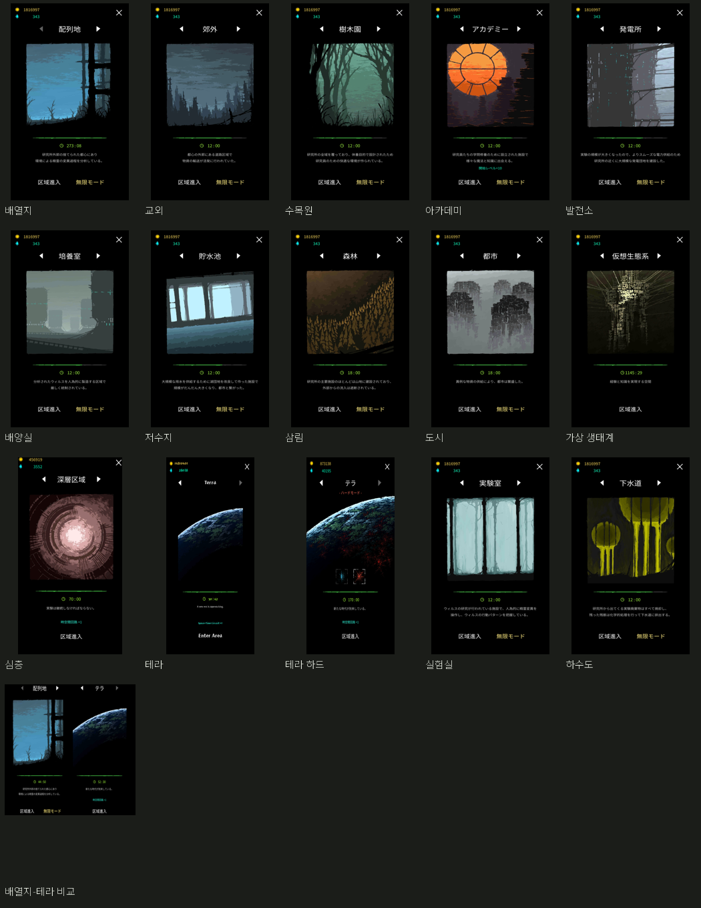
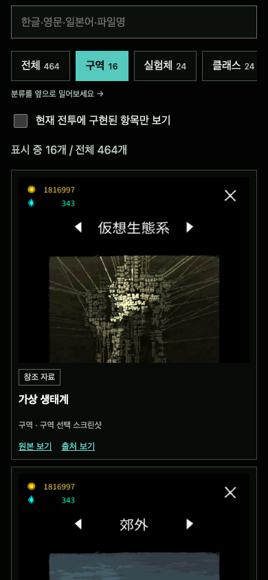
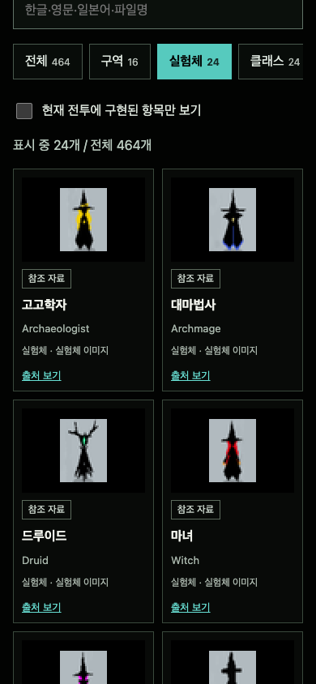

# 원작 이미지 모음 확장

2026-10-29. 기존 제공 자료265장에 공개 원작 참조199장을 더해464장의 고유 이미지를 보관했다. [자료관](../../atlas.html), [원본 모음과 출처](../../assets/references/README.md), [기계 판독 목록](../../assets/references/catalog.json).

| 분류 | 이미지 수 | 종류 |
| --- | ---: | --- |
| 구역 | 16 | 기본 구역14종 + 테라 하드 + 비교1장 |
| 실험체 | 24 | 30×40 참조 이미지 |
| 클래스 | 24 | 40×40 아이콘 |
| 적 / 보스 | 8 | 각각4종, 게임 화면 일부 포함 |
| 마법 | 58 | 기존 제공 아이콘 |
| 유물 | 153 | 기존 제공 아이콘 |
| 패시브 | 55 | 기존30 + 신규25 |
| 연구 | 40 | 기존20 + 신규20 |
| 필드 아이템 | 20 | 구슬·상자·룬·상인 등 |
| 시너지 | 35 | 공개 팬 위키 이미지 |
| 화면 | 22 | 공식 스토어와 선택·정보 화면 등 |
| UI | 9 | 기존4 + 신규5 |
| 합계 | 464 | 464개의 서로 다른SHA-256 |

## 검증

201개 고유 참조 URL을 모두 수집해 검사했다. 신규199개와 정확한 중복2개로 기록했으며 실패0개다. 기존 포함464개 전체의 SHA-256과 실제 이미지 전체 디코딩이 통과했다. 원본 바이트는 수정하지 않았다. ZIP은473개 항목, 약34.6MB이며 CRC와464개 이미지의 저장 해시를 대조했다. 글꼴·카탈로그·오프라인도감이 추가 항목이다.

수집 중 실패하면 종료코드1을 반환하고 이전 완성 카탈로그를 유지한다. 실패 보고서는 .omx에 따로 남긴다. 성공 때만 카탈로그를 원자적으로 교체한다. 헤더 검사를 통과하는 잘린JPEG도 전체 디코딩에서 거부한다. 두 실패 조건을 먼저 재현한 뒤 회귀 테스트2개가 통과했다.

모바일320/390px에서 분류·한글/영어/일본어 검색·원본/출처 분리·정직한 구현 필터·이미지 로딩과 가로 넘침 없음을 확인했다. 독립 시각 검토94점, 코드 검토 승인. 기존 게임 테스트35개와 문법 검사도 통과했다. Godot 게임 규칙과 APK 포함 자산은 바꾸지 않았다.

이 모음은 공개 자료로 확보한 이미지 목록이며 게임 전체 내부 자산 덤프가 아니다. 원작 선택 화면의 자원과 기록은 출처 스크린샷의 일부다. 새 맵/클래스/마법이 구현됐다는 의미가 아니며 배경타일·투명 애니메이션 시트·적 패턴은 별도 작업이다. 팬 위키 자료는 버전 차이가 있을 수 있다. 수집한 원본과 참조 기반 생성6종은 별도 폴더와 장부를 유지한다.

## 공개 배포 확인

[자료관](https://choijunhuk.github.io/magic-survival-lab/atlas.html) · [전체 ZIP](https://choijunhuk.github.io/magic-survival-lab/reference-assets.zip).

[배포40870016637](https://github.com/choijunhuk/magic-survival-lab/actions/runs/40870016637)가 성공했고 build-info는 d8799a4 커밋과 일치했다. 공개 서버의464개 파일 전부 HTTP200, 모바일에서 Pyromancer 검색→화염술사1건, 원본/출처 분리, 가로 넘침 없음과 콘솔 오류 없음을 확인했다. 공개 ZIP을 다시 내려받아473항목 CRC와464이미지 해시가 원본 장부와 일치함을 확인했다. 구역 수는 기본14종과 테라 하드 변형1개를 구별한다.

최종 배포 [40870704299](https://github.com/choijunhuk/magic-survival-lab/actions/runs/40870704299)도 성공했다. 공개 build-info의 d499515 커밋, coverage의 기본14구역·변형1개·비교1장, 최종 ZIP의473항목 CRC와464이미지 해시를 다시 확인했다.
